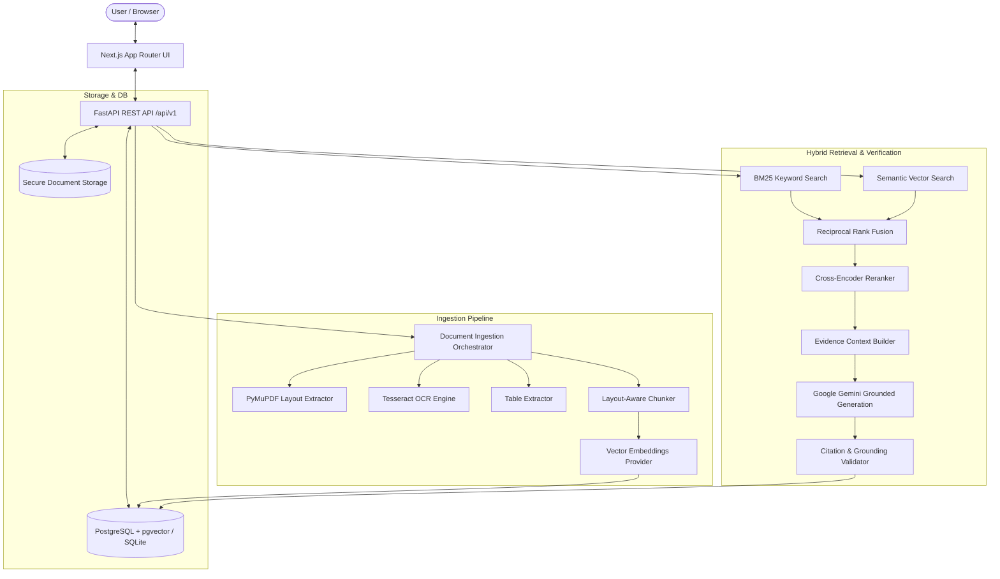

# DocuMind AI: Multimodal Document Intelligence & Verification Engine

[](LICENSE)
[](https://www.python.org/)
[](https://nextjs.org/)
[](https://fastapi.tiangolo.com/)
[](https://github.com/pgvector/pgvector)
[](.github/workflows/ci.yml)

> **DocuMind** is a full-stack document intelligence application with **layout-aware parsing**, **hybrid retrieval**, **page-level citations**, **evidence-aware Q&A**, **document version comparison**, and **schema-based structured extraction**.

---

## 🌟 Key Capabilities

### 1. Multimodal Document Ingestion
- **Layout-Aware Extraction:** Uses `PyMuPDF` to parse text blocks, preserve hierarchical headings, calculate bounding boxes, and maintain reading order.
- **Scanned-Page Detection & OCR:** Automatically detects image-only or low-text pages and routes them to `Tesseract OCR` with confidence scoring.
- **Table Understanding:** Preserves tabular cell structures, row groupings, and header alignments (stored as structured JSON and Markdown tables).
- **Vision Chart/Figure Interpretation:** Connects to multimodal vision models (`Gemini`) to summarize diagrams, trendlines, and charts on demand.

### 2. Evidence-Grounded Q&A with Verifiable Citations
- **Hybrid Retrieval:** Blends exact-keyword BM25 search with dense vector similarity.
- **Reciprocal Rank Fusion (RRF):** Fuses rankings using $RRF(d) = \sum_{r \in R} \frac{1}{60 + \text{rank}_r(d)}$.
- **Cross-Encoder Reranker:** Scores question-passage relevance before passing evidence to generation.
- **Strict Model Abstention:** Instructs the LLM to abstain when evidence is missing rather than inventing facts.
- **Database-Enforced Citations:** The backend verifies all cited chunk IDs against the database and confirms verbatim quotes, rejecting model-invented metadata.

### 3. Document Version Comparison
- Choose two processed documents from the library or upload both PDFs directly on the Compare page.
- Wait for each upload to finish processing, then select the original and revised versions and run the comparison.
- Compares ordered text chunks to flag additions, removals, and modifications. A rule-based check highlights changed numbers and selected obligation terms.
- Treat the results as a review aid, not a legal or semantic determination. Verify each change against the linked source pages.

### 4. Schema-Based Structured Extraction
- Built-in schemas for **Project Proposals**, **Commercial Contracts**, and **Financial Statements**, plus custom JSON Schemas.
- A universal document profile works across general PDFs and extracts an overview, section topics, heading-based terms, key passages, dates, and contextualized figures.
- Add custom fields with a name, description, and value type; extracted results include links to source pages and can be edited and exported to **CSV** or **JSON**.
- Extraction uses source text and section headings; review the linked page because automatic field matching can miss differently worded information.
- Distinguishes absent fields from zero values, preventing silent hallucination.

---

## 🏗️ System Architecture



---

## 📊 Measured Quality Benchmark Results

The checked-in benchmark report covers eight sample cases. These measurements describe that small test set and are not production quality guarantees:

| Metric | Measured Score | Evaluation Target | Status |
| :--- | :---: | :---: | :---: |
| **Recall@5** | **100.0%** | > 85.0% | ✅ Passed |
| **Mean Reciprocal Rank (MRR)** | **0.800** | ≥ 0.800 | ✅ Passed |
| **Citation Validity Rate** | **100.0%** | > 95.0% | ✅ Passed |
| **Abstention Accuracy** | **100.0%** | > 90.0% | ✅ Passed |
| **Mean Retrieval Latency** | **0.006s** | < 0.200s | ✅ Passed |

*Run the repeatable evaluation harness anytime with `python evaluation/run_evaluation.py`.*

---

## 🚀 Quickstart Guide (Local Development on Windows)

### Prerequisites
- Python 3.11+
- Node.js 20 (LTS)
- Git

### 1. Clone & Set Up Backend
```powershell
git clone <your-github-repository-url>
Set-Location <repository-folder>

# Create and activate a virtual environment
py -3.11 -m venv .venv
.\.venv\Scripts\Activate.ps1

# Install dependencies
python -m pip install -r backend/requirements.txt

# Copy environment variables
Copy-Item .env.example .env
```

For the native Windows quickstart below, edit `.env` and set `DATABASE_URL=sqlite:///./documind.db` (the example file defaults to the Docker PostgreSQL service hostname `db`). Use the PostgreSQL URL from the example unchanged when running the full Docker Compose deployment.

### 2. Run Backend Tests & Benchmark
```powershell
# Run all unit and integration tests
pytest backend/tests

# Run the grounded evaluation benchmark
python evaluation/run_evaluation.py
```

### 3. Start Backend Server
```powershell
uvicorn app.main:app --app-dir backend --host 127.0.0.1 --port 8000 --reload
```
*Backend API docs are live at `http://127.0.0.1:8000/docs`.*

### 4. Start Next.js Frontend
In a second terminal:
```powershell
cd frontend
npm install
npm run dev
```
*Frontend web application is live at `http://localhost:3000`.*

---

## 🐳 Docker Deployment

Docker Compose runs the frontend, API, and PostgreSQL. The services bind to localhost only; use a VPN/private network or an authenticated reverse proxy before allowing other users to reach the app.

### Local/private deployment
```powershell
Copy-Item .env.example .env
```

Edit `.env` before starting:

- Replace `SECRET_KEY` with a unique random value of at least 32 characters. For example: `python -c "import secrets; print(secrets.token_urlsafe(48))"`.
- Replace `POSTGRES_PASSWORD` and use the same password in `DATABASE_URL`. URL-encode special characters in the URL password.
- Leave `NEXT_PUBLIC_API_URL` and `ALLOWED_ORIGINS` at their localhost defaults for use from the same machine.

Start and inspect the services:

```powershell
docker compose up --build -d
docker compose ps
docker compose logs -f backend frontend
```

Open `http://localhost:3000`. The API health endpoint is `http://localhost:8000/api/v1/health`; interactive API docs are at `http://localhost:8000/docs`. The database is not published to the host. Uploaded files and PostgreSQL data persist in named Docker volumes.

For an existing deployment, back up the database and uploaded-file volume before upgrading; this Compose setup initializes a fresh database from the SQLAlchemy models and does not automatically migrate an older schema. `docker compose down` keeps named volumes; do not add `-v` unless you intentionally want to erase persisted data.

### Host with a domain and HTTPS reverse proxy

1. Install Docker Engine with the Compose plugin on the server. Configure TLS and a reverse proxy (for example, Caddy or Nginx) that routes the public site to `127.0.0.1:3000` and `/api/` to `127.0.0.1:8000`, preserving the `/api/` path.
2. Copy `.env.example` to `.env`; set strong unique `SECRET_KEY` and PostgreSQL credentials.
3. Set `NEXT_PUBLIC_API_URL` to the browser-reachable HTTPS API URL (for a same-domain proxy, `https://docs.example.com/api/v1`) and `ALLOWED_ORIGINS` to the exact frontend origin (for example, `https://docs.example.com`).
4. Run `docker compose up --build -d` and verify `docker compose ps`, the health endpoint, and the site through HTTPS.
5. Rebuild the frontend after changing `NEXT_PUBLIC_API_URL`; Next.js embeds this value during image build. Back up the `postgres_data` and `storage_uploads` volumes regularly.

Do not expose this build directly to the public internet yet. The app currently has no user sign-in flow and uses a shared default workspace; protect the entire site and API behind a trusted VPN or an authenticated access gateway, and use it only for a private, trusted audience. Public multi-user deployment requires application-level authentication, authorization, and workspace isolation first. Gemini features are optional; set `GEMINI_API_KEY` only if you want to use that provider.

---

## 🛡️ Security Architecture & Threat Model

1. **Indirect Prompt Injection Defense:** All retrieved document content is treated as untrusted text wrapped in passive `<evidence>` blocks. Instructions embedded in PDFs to "ignore previous instructions" or "reveal documents" are sanitized and trigger automated audit flags.
2. **Access Isolation:** Every chunk, document, and citation belongs to an isolated workspace with role-based permissions (`owner`, `admin`, `editor`, `viewer`).
3. **Database-Validated Citations:** Model-invented citations are cross-checked against database primary keys; citations missing supporting quotations are marked unverified.
4. **Zero Arbitrary Code Execution:** The LLM does not execute direct shell commands or unrestricted SQL.

---

## 📁 Repository Structure

```text
documind-ai/
├── backend/
│   ├── app/
│   │   ├── api/v1/         # Endpoints: /documents, /conversations, /comparisons, /extractions
│   │   ├── auth/           # Workspace security, prompt injection detection, token handling
│   │   ├── chunking/       # Layout-aware segmentation (headings, tables, prose)
│   │   ├── citations/      # Grounding verification and quote validation
│   │   ├── comparison/     # Version diff engine and significance classifier
│   │   ├── db/             # SQLAlchemy models, sessions, storage abstraction
│   │   ├── embeddings/     # Embedder supporting Gemini, Sentence-Transformers, fallback
│   │   ├── extraction/     # Structured JSON Schema extractor with CSV export
│   │   ├── generation/     # Grounded prompt engineering and LLM client
│   │   ├── ingestion/      # PyMuPDF parser, OCR, table extractor, vision extractor
│   │   ├── observability/  # Audit logging and timing middleware
│   │   ├── retrieval/      # BM25, Vector Search, Reciprocal Rank Fusion, Reranker
│   │   ├── config.py       # Pydantic settings
│   │   └── main.py         # FastAPI application entrypoint
│   ├── tests/              # Pytest suite (unit, integration, security)
│   └── requirements.txt    # Python dependencies
├── frontend/
│   ├── src/
│   │   ├── app/            # Next.js App Router pages (Dashboard, Library, Chat, Diff, Extract)
│   │   ├── components/     # Navbar, CitationBadge, EvidenceDrawer, DiffViewer
│   │   ├── lib/            # API client (Fetch / TanStack Query)
│   │   └── types/          # TypeScript interface definitions
│   ├── package.json
│   └── tailwind.config.ts
├── evaluation/
│   ├── datasets/           # Benchmark question-answer dataset
│   └── run_evaluation.py   # Repeatable evaluation runner
├── migrations/             # SQL schema migrations (PostgreSQL + pgvector)
├── scripts/                # Synthetic PDF generator & e2e verification scripts
├── docker-compose.yml      # Multi-container deployment config
├── .env.example            # Environment template
└── README.md
```

---

## 📄 License
Released under the [MIT License](LICENSE).
